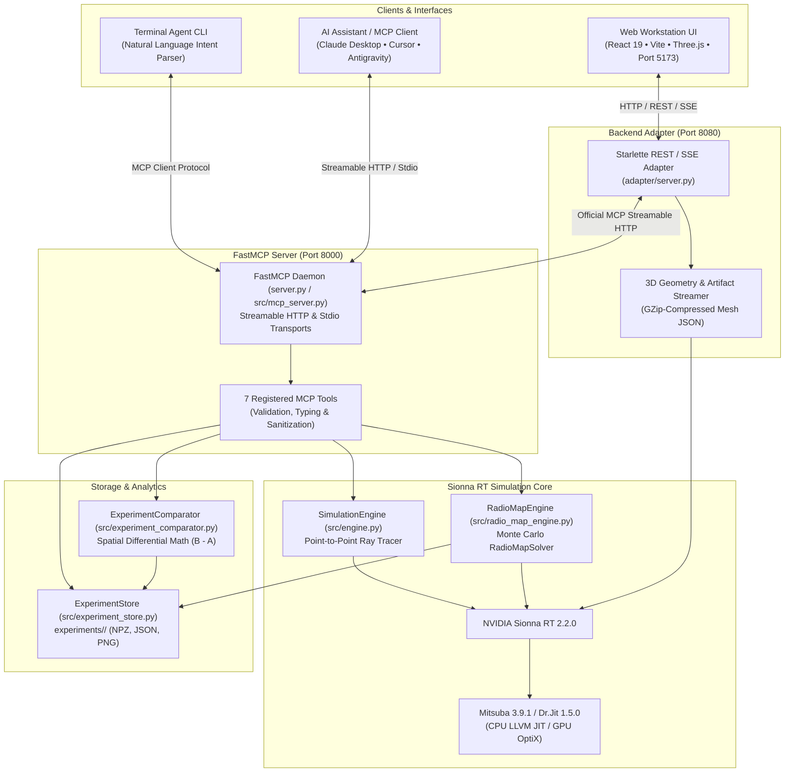

# NVIDIA Sionna RT Model Context Protocol (MCP) Server & Simulation Workstation

[](https://www.python.org/)
[](https://developer.nvidia.com/sionna)
[](https://www.mitsuba-renderer.org/)
[](https://modelcontextprotocol.io/)
[]()
[]()
[](LICENSE)

A production-grade **Model Context Protocol (MCP)** server and scientific simulation workstation that enables AI clients (such as Claude Desktop, Cursor, Antigravity, or autonomous LLM agents) and engineers to configure, execute, analyze, and compare **NVIDIA Sionna RT** physical wireless ray-tracing simulations.

---

## 1. Project Overview

**NVIDIA Sionna RT** is a state-of-the-art, differentiable electromagnetic ray tracer designed for radio wave propagation simulation in complex 3D environments. This project exposes Sionna RT's core computational physics capabilities via the official Model Context Protocol (MCP) and pairs them with an interactive full-stack scientific workstation.

The system empowers AI systems and human researchers to:
- Perform 3D point-to-point multipath propagation simulations with physical channel impulse response (CIR) analysis.
- Compute 2D planar radio coverage maps (heatmaps) over continuous spatial evaluation surfaces at designated receiver heights.
- Persist, catalog, and query simulation experiments on disk with IEEE-754 numerical fidelity.
- Perform spatial difference analysis ($B - A$ convention) across pairs of experiments to evaluate frequency, antenna, and environmental changes.
- Visualize real 3D mesh urban geometries and ray paths in an interactive Three.js viewport.
- Drive the entire workflow either via an interactive Web GUI, an autonomous natural language Terminal Agent, or standard MCP tool calls.

---

## 2. Main MVP Features

### 1. Three Canonical 3D Geometric Scenes
The platform strictly standardizes on three realistic propagation environments:
- **`munich` (Munich Urban Core)**: Dense European city center with intricate building architecture (34,044 vertices, 38,936 faces, 11 distinct mesh structures). Default carrier: 3.5 GHz Sub-6.
- **`san_francisco` (San Francisco Urban Hills)**: Steep topographical terrain combined with coastal downtown high-rises (177,359 vertices, 268,041 faces).
- **`simple_street_canyon`**: Standard urban micro-cell canyon benchmark with multi-story facades and direct reflection corridors (52 vertices, 74 faces).
- **Persistent Navbar Selection**: Active scene selection is preserved globally across all views via `localStorage`, automatically synchronizing default coordinates, grid margins, experiment filters, and 3D visualizers.

### 2. 3D Ray Tracing & Point-to-Point Workbench (`/p2p`)
- **Electromagnetic Decomposition**: Resolves individual multipath components: Line of Sight (LOS), Specular Reflection, Edge Diffraction, and Diffuse Scattering.
- **Physical Metrics**: Time-of-flight delays (ns), propagation distances (m), individual path gains (dB), total path loss (dB), received power (dBm), and dynamic RMS delay spread calculation.
- **Interactive 3D Visualizer**: Real Three.js PBR mesh rendering, OrbitControls (rotate, pan, zoom), camera presets (Isometric, Top XY, Side XZ), and dynamic coordinate mapping ($[X, Y, Z] \to [X, Z, -Y]$).
- **RF Validation**: Channel Impulse Response (CIR) stem plots, Friis free-space loss verification, and robust IEEE-754 float sanitization (safe handling of non-finite `inf`/`nan` values for blocked receivers).

### 3. 2D Planar Radio Coverage Map Generator (`/radio-maps`)
- **Monte Carlo Ray Solver**: Native integration with Sionna RT's `RadioMapSolver` handling configurable ray budgets ($10^4$ to $10^6$ rays per transmitter) and bounce depths (1–5).
- **Planar Grid Evaluation**: Computes planar coverage at pedestrian receiver height ($Z = 1.5\text{ m}$) using either AUTO (scene-bounded) or MANUAL bounding boxes.
- **Dual Visual Modes**: Instant toggling between Received Signal Strength ($\text{RSS}$ in $\text{dBm}$) and Channel Path Gain ($\text{dB}$).
- **Statistical Analytics**: Coverage percentage, maximum/minimum/mean RSS, active surface area, and cell resolution metrics.

### 4. Experiment Storage & Archival Library (`/experiments`)
- **Atomic Disk Persistence**: Automatic storage in `experiments/experiment_<timestamp>_<uuid>/` using temporary staging directories to prevent partial write corruption.
- **IEEE-754 Preservation**: Unreached cells retain exact mathematical $- \infty$ values in compressed `radio_map_data.npz` arrays without artificial noise floor distortion (`allow_pickle=False`).
- **Artifact Generation**: Full simulation configuration stored in `metadata.json` alongside 150 DPI publication-quality heatmaps (`rss_heatmap.png`, `path_gain_heatmap.png`).
- **Scene-Scoped Browsing**: The experiment library automatically scopes listings to the active navbar scene, with deep-search and frequency band filters (Sub-6 GHz vs. mmWave).

### 5. Spatial Difference & Comparison Suite (`/compare`)
- **Quantitative Delta Analysis**: Subtracts two compatible experiments sharing identical spatial grids:
  $$\Delta \text{RSS} = \text{RSS}_B - \text{RSS}_A \quad (\text{dB})$$
  $$\Delta \text{Path Gain} = \text{Gain}_B - \text{Gain}_A \quad (\text{dB})$$
- **Centered Diverging Heatmaps**: Matplotlib-rendered diverging difference maps centered at $0\text{ dB}$ (Blue = Improvement, Red = Degradation, Transparent = Unreached).
- **Comparative Metrics**: Mean delta, maximum improvement, maximum degradation, active cell overlap, and spatial Pearson correlation coefficient.
- **Safety Safeguards**: Strict spatial boundary validation ensures mismatched scenes, heights, or cell grids cannot trigger erroneous comparisons.

### 6. Official Model Context Protocol (FastMCP)
- Exposes **7 standard tools** callable by any MCP client (Claude Desktop, Cursor, Antigravity, or custom LLM agents).
- Dual transport support: high-performance **Streamable HTTP** (`http://127.0.0.1:8000/mcp`) and **Stdio** for subprocess execution.

### 7. Autonomous Interactive Terminal Agent
- Standalone CLI agent (`python -m src.terminal_agent`) with intent recognition, parameter extraction, and natural-language prompt parsing for hands-free simulation execution and comparison.

---

## 3. Architecture Overview

The system strictly enforces layered separation of concerns between computational physics, daemon routing, and user presentation:



---

## 4. Repository Structure

```text
Sionna_RT_MCP/
├── adapter/                                 # Lightweight Starlette Backend Adapter (Port 8080)
│   └── server.py                            # Bridges React UI to FastMCP server, serves meshes & artifacts
├── frontend/                                # React 19 + TypeScript + Three.js + Vite Web Application
│   ├── src/
│   │   ├── components/                      # Modular UI components (Header, Sidebar, 3D Visualizer)
│   │   │   ├── layout/                      # Application shell and persistent Navbar scene selector
│   │   │   └── simulation/                  # RayTracingVisualizer3D (Three.js real mesh renderer)
│   │   ├── context/                         # SceneContext (persisted active scene state & configs)
│   │   ├── pages/                           # Workstation pages (Overview, P2P, RadioMaps, Experiments, etc.)
│   │   ├── services/                        # Typed MCP client and REST API service layer
│   │   ├── hooks/                           # TanStack React Query hooks for simulation and telemetry
│   │   └── types/                           # Strict TypeScript schemas for tools, geometry, and results
│   ├── package.json
│   └── vite.config.ts
├── docs/                                    # Technical architectural documentation
│   ├── ARCHITECTURE.md                      # Detailed system architecture and data-flow specifications
│   ├── MCP_TOOLS_REFERENCE.md               # Complete schema and argument reference for all 7 tools
│   ├── EXPERIMENT_STORAGE.md                # Filesystem layout, IEEE-754 handling, and artifact formats
│   └── WINDOWS_SETUP.md                     # Platform-specific Windows 11 installation instructions
├── experiments/                             # Stored radio map simulation experiments
│   ├── comparisons/                         # Diverging delta heatmap artifacts (*.png)
│   └── experiment_<timestamp>_<uuid>/       # Stored simulation runs
│       ├── metadata.json                    # Configuration parameters and summary statistics
│       ├── radio_map_data.npz               # Compressed IEEE-754 numerical matrices (RSS, Gain, Coordinates)
│       ├── rss_heatmap.png                  # Received Signal Strength coverage heatmap
│       └── path_gain_heatmap.png            # Channel Path Gain coverage heatmap
├── scripts/                                 # Verification and utility scripts
│   ├── benchmark_performance.py             # Performance and RAM benchmarking utility
│   ├── verify_env.py                        # Environment sanity check script
│   ├── verify_mcp_client.py                 # Point-to-point MCP client verification
│   └── verify_radio_map_workflow.py         # Full radio-map MCP workflow verification
├── src/                                     # Core package implementation
│   ├── engine.py                            # Point-to-point ray tracing SimulationEngine
│   ├── config.py                            # SimulationConfig dataclass and validation
│   ├── result.py                            # SimulationResult dataclass
│   ├── radio_map_engine.py                  # RadioMapEngine executing Monte Carlo RadioMapSolver
│   ├── radio_map_config.py                  # RadioMapConfig dataclass and validation
│   ├── radio_map_result.py                  # RadioMapResult numerical tensor extraction
│   ├── radio_map_formatter.py               # Heatmap generation and summary formatting
│   ├── experiment_store.py                  # Atomic filesystem experiment storage
│   ├── experiment_comparator.py             # Spatial difference analysis ($B - A$)
│   ├── mcp_server.py                        # FastMCP server exposing 7 registered tools
│   ├── storage.py                           # P2P simulation results storage
│   └── terminal_agent/                      # Natural language CLI Agent
│       ├── client.py                        # MCP client connection wrapper
│       ├── intent.py                        # Intent classification
│       ├── parser.py                        # Entity and parameter extraction
│       ├── validator.py                     # Schema validation
│       └── executor.py                      # Multi-turn execution loop
├── tests/                                   # Full automated test suite (269 unit, integration, and E2E tests)
├── start.sh                                 # Linux/WSL one-click stack launcher
├── start_sionna_lab.py                      # Cross-platform unified Python stack launcher
├── requirements.txt                         # Python dependencies
└── README.md                                # Project documentation
```

---

## 5. Prerequisites & Environment Setup

### System Requirements
- **Operating System:** Linux (Ubuntu 20.04+, Debian 11+), WSL2, or Windows 11 (64-bit).
- **Python:** CPython 3.10 or 3.11 64-bit (Python 3.14+ is **not** supported due to binary wheel requirements for `mitsuba` and `drjit`).
- **Node.js / Bun:** Bun (recommended) or Node.js 18+ (for building and serving the frontend).
- **Hardware:** Modern x86_64 CPU with AVX2 support (Intel 10th Gen+ or AMD Ryzen 3000+); 16 GB RAM recommended.

### Python Environment Installation
```bash
# 1. Clone the repository
git clone https://github.com/your-username/Sionna_RT_MCP.git
cd Sionna_RT_MCP

# 2. Create and activate virtual environment
python3 -m venv .venv
source .venv/bin/activate    # On Windows: .venv\Scripts\activate

# 3. Install core dependencies
pip install --upgrade pip
pip install -r requirements.txt
pip install matplotlib
```

### Frontend Dependencies Installation
```bash
cd frontend
bun install     # or: npm install
cd ..
```

---

## 6. How to Run

### Method 1: One-Click Unified Launcher (Recommended)
The project provides a unified launcher that starts all three layers simultaneously with clean subprocess management and non-blocking I/O pipes:

```bash
# On Linux / macOS / WSL:
./start.sh

# Or directly with Python (Cross-platform Linux / Windows):
python3 start_sionna_lab.py
```

This single command initializes:
1. **NVIDIA Sionna RT FastMCP Server**: `http://localhost:8000/mcp` (Streamable HTTP)
2. **Sionna Lab Backend Adapter**: `http://localhost:8080` (Starlette REST, SSE & Mesh Streamer)
3. **Vite React 19 Frontend**: `http://localhost:5173` (Interactive Workstation UI)

Open **`http://localhost:5173`** in your browser to access the simulation workstation.

---

### Method 2: Running Services Individually
If you prefer running services in separate terminal tabs:

#### 1. Start the FastMCP Server (Port 8000)
```bash
source .venv/bin/activate
python server.py --transport streamable-http --host 0.0.0.0 --port 8000
```

#### 2. Start the Backend Adapter (Port 8080)
```bash
source .venv/bin/activate
python adapter/server.py
```

#### 3. Start the Frontend Development Server (Port 5173)
```bash
cd frontend
bun run dev     # or: npm run dev
```

---

### Method 3: Running the Interactive Terminal Agent
To interact with Sionna RT using natural language commands in your terminal:

```bash
source .venv/bin/activate
python -m src.terminal_agent
```

You can enter conversational requests such as:
- *"Check the environment health and active backend."*
- *"Show me all available 3D geometric scenes."*
- *"Run a point-to-point simulation in Munich at 3.5 GHz from [0, 0, 35] to [60, 20, 1.5]."*
- *"Generate a 2D coverage map for San Francisco at 5.8 GHz with 25m cell size."*
- *"List all saved experiments."*
- *"Compare the last two radio map experiments in Munich."*

---

### Method 4: Connecting to AI Assistants (Claude Desktop, Antigravity, Cursor)

#### Streamable HTTP Mode (Recommended)
When `server.py` is running, add the server definition to your client configuration:

**Antigravity (`~/.gemini/config/mcp_config.json`):**
```json
{
  "mcpServers": {
    "sionna-rt": {
      "url": "http://127.0.0.1:8000/mcp"
    }
  }
}
```

**Claude Desktop (`claude_desktop_config.json`):**
```json
{
  "mcpServers": {
    "sionna-rt": {
      "url": "http://127.0.0.1:8000/mcp"
    }
  }
}
```

#### Stdio Mode (Direct Subprocess)
To run the server as a local stdio subprocess managed directly by Claude Desktop:
```json
{
  "mcpServers": {
    "sionna-rt": {
      "command": "/path/to/Sionna_RT_MCP/.venv/bin/python",
      "args": [
        "/path/to/Sionna_RT_MCP/src/mcp_server.py"
      ],
      "env": {
        "PYTHONIOENCODING": "utf-8"
      }
    }
  }
}
```

---

## 7. Available MCP Tools Reference

The FastMCP server exposes seven production tools designed for scientific accuracy and full schema validation:

| Tool | Purpose | Primary Parameters | Key Defaults |
| :--- | :--- | :--- | :--- |
| **`check_environment`** | Verify runtime environment, simulator availability, and active Mitsuba backend (`llvm_ad_mono_polarized`). | *None* | — |
| **`list_scenes`** | Catalog the 3 supported 3D geometric propagation scenes and their characteristics. | *None* | `default_scene: "munich"` |
| **`run_simulation`** | Execute physical 3D electromagnetic ray tracing between TX and RX coordinates. | `scene`, `frequency_hz`, `tx_position`, `rx_position`, `tx_power_dbm` | `scene: "munich"`, `freq: 3.5e9`, `power: 30.0 dBm` |
| **`generate_radio_map`** | Run Monte Carlo planar coverage simulation, persist numerical arrays, and render heatmaps. | `scene_name`, `frequency_hz`, `tx_position`, `tx_power_dbm`, `receiver_height`, `cell_size`, `samples_per_tx`, `max_depth` | `height: 1.5m`, `cell_size: 1.0m`, `samples: 1,000,000` |
| **`list_experiments`** | Retrieve lightweight summaries (metadata, metrics, and heatmap flags) of all stored experiments without loading large arrays. | *None* | Sorted newest first |
| **`get_experiment_details`** | Retrieve complete configuration metadata, array dimensions, and artifact file paths for a saved experiment. | `experiment_id` | Required |
| **`compare_experiments`** | Calculate spatial differences ($B - A$) between two experiments on the same scene and render diverging delta heatmaps. | `experiment_id_a`, `experiment_id_b`, `generate_heatmaps` | Diverging centered at 0 dB |

For full parameter definitions, typing constraints, and JSON schemas, see [`docs/MCP_TOOLS_REFERENCE.md`](docs/MCP_TOOLS_REFERENCE.md).

---

## 8. Running Tests and Verification

The repository includes a comprehensive, automated test suite covering unit logic, numerical solvers, MCP protocol compliance, and end-to-end integration:

### 1. Run Complete Python Test Suite
```bash
source .venv/bin/activate
python -m unittest discover tests
# or:
pytest -v
```
**Test Coverage:** **269 passed tests** across unit, validation, adapter, and terminal agent modules.

### 2. Verify Frontend Production Build
```bash
cd frontend
bun run build    # or: npm run build
```
Ensures zero TypeScript compiler errors and produces an optimized production bundle.

### 3. Backend Adapter Health Verification
```bash
curl -s http://127.0.0.1:8080/api/health
```

### 4. Performance & Scalability Benchmarking
```bash
python scripts/benchmark_performance.py
```

---

## 9. Performance Benchmarks

Benchmarked with CPU LLVM backend `llvm_ad_mono_polarized`:

| Grid Resolution | Cell Size | Evaluation Grid | Total Cells | Rays / TX | Solver Time | Heatmap Gen | Total Pipeline | Peak RAM |
| :--- | :---: | :---: | :---: | :---: | :---: | :---: | :---: | :---: |
| **Coarse Grid** | $5.0\text{ m}$ | $5 \times 3$ | 15 | 10,000 | 1.703 s* | 0.414 s | 2.139 s | 183.2 MB |
| **Medium Grid** | $2.5\text{ m}$ | $9 \times 5$ | 45 | 10,000 | 0.024 s | 0.395 s | 0.449 s | 192.4 MB |
| **Fine Grid** | $1.0\text{ m}$ | $21 \times 11$ | 231 | 20,000 | 0.024 s | 0.379 s | 0.435 s | 201.3 MB |

*\*Initial execution includes one-time Dr.Jit LLVM JIT compilation warmup (~1.7s). Subsequent warm simulations execute in **~24 ms**.*

---

## 10. Experiment Storage Schema

Every saved experiment is stored in an isolated folder under `experiments/experiment_<id>/`:

```text
experiments/
├── comparisons/
│   └── diff_expA_vs_expB_rss.png      # Diverging difference heatmap
└── experiment_20261113_050236_06b91268/
    ├── metadata.json                  # Simulation parameters, timestamps & coverage stats
    ├── radio_map_data.npz             # IEEE-754 linear and dB power arrays (allow_pickle=False)
    ├── rss_heatmap.png                # Received power heatmap (dBm, 150 DPI)
    └── path_gain_heatmap.png          # Channel path gain heatmap (dB, 150 DPI)
```

- **Path Traversal Protection**: Experiment IDs are strictly sanitized against relative path manipulation (`..`, `/`, `\`).
- **Atomic Operations**: All writes stage in `.tmp_*` folders before atomic rename, ensuring zero corrupted or half-written states.
- For complete schema details, see [`docs/EXPERIMENT_STORAGE.md`](docs/EXPERIMENT_STORAGE.md).

---

## 11. Known Limitations & Compatibility Notes

1. **CPU LLVM Backend**: Simulations execute via Mitsuba's CPU LLVM variant (`llvm_ad_mono_polarized`). GPU CUDA/OptiX acceleration requires an NVIDIA GPU with native Linux CUDA toolchain.
2. **Supported Scenes**: Supported scenes are strictly limited to `munich`, `san_francisco`, and `simple_street_canyon`.
3. **Single Active Transmitter**: Radio maps evaluate coverage for a single active transmitter array per simulation run.
4. **Headless Visualizations**: Heatmap rendering utilizes Matplotlib's non-interactive `Agg` backend for headless server execution.

---

## 12. License

This project is licensed under the **Apache License 2.0**.  
NVIDIA Sionna RT is licensed under Apache 2.0. Mitsuba 3 is licensed under the BSD-3-Clause license.
