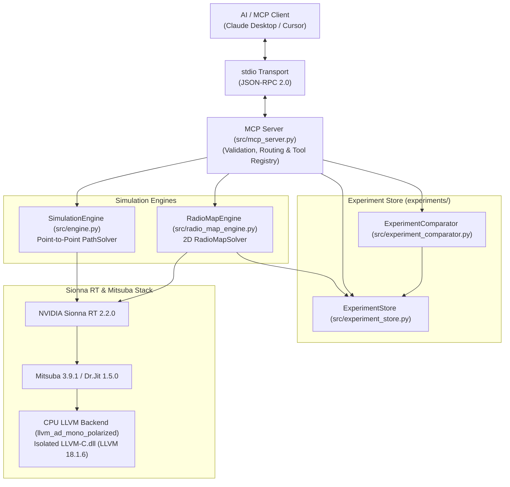
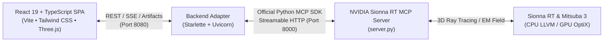

# NVIDIA Sionna RT Model Context Protocol (MCP) Server

[](https://www.python.org/downloads/release/python-31010/)
[](https://developer.nvidia.com/sionna)
[](https://www.mitsuba-renderer.org/)
[](https://modelcontextprotocol.io/)
[]()
[]()

A production-grade **Model Context Protocol (MCP)** server that enables AI clients (such as Claude Desktop, Cursor, or autonomous LLM agents) to configure, execute, analyze, and compare **NVIDIA Sionna RT** wireless ray-tracing simulations through standardized tools.

---

## 1. Project Overview

**NVIDIA Sionna RT** is an industrial-strength, differentiable ray tracer designed for radio wave propagation simulation in complex 3D environments. This project exposes Sionna RT's core capabilities via the official Model Context Protocol (MCP), enabling AI systems to:
- Perform point-to-point multipath propagation simulations.
- Generate 2D spatial radio coverage maps (heatmaps) over continuous evaluation surfaces.
- Store, catalog, and query simulation experiments on the local filesystem.
- Compare pairs of experiments using spatial difference analysis ($B - A$ convention).

The server operates over standard input/output (`stdio`) using JSON-RPC 2.0 messages.

---

## 2. Main Capabilities

- **Point-to-Point Ray Tracing:** Resolves multipath propagation components (Line of Sight, Specular Reflections, Diffuse Scattering, Diffraction), path delays, geometric distances, and per-path gains.
- **2D Spatial Radio Maps:** Evaluates planar coverage at arbitrary receiver heights using Sionna RT's native `RadioMapSolver`. Supports AUTO (scene-derived) and MANUAL bounding boxes.
- **Publication-Quality Heatmaps:** Renders high-resolution (150 DPI) Received Signal Strength (RSS in dBm) and Path Gain (dB) visual heatmaps with neutral gray masking for unreachable cells.
- **Reproducible Scaling:** Deterministic random seeds produce bit-identical results ($\Delta = 0.0000$ dB). Transmit power scaling ($+10$ dBm) produces an exact $+10.0000$ dB RSS shift and $0.0000$ dB path gain shift.
- **Filesystem Experiment Store:** Atomic persistence of metadata JSON, compressed NPZ float64 numerical arrays, and PNG heatmaps with path traversal protection.
- **Spatial Difference Analysis:** Computes spatial differences ($B - A$) between compatible experiments, masking unreached cells and rendering centered diverging difference heatmaps.
- **High-Performance CPU LLVM JIT:** Executes on native Windows 11 via Mitsuba CPU LLVM (`llvm_ad_mono_polarized`), achieving warm solver runtimes under **25 milliseconds**.

---

## 3. Architecture Overview

The system strictly enforces layered separation of concerns:



For complete architectural details, see [`docs/ARCHITECTURE.md`](docs/ARCHITECTURE.md).

---

## 4. Repository Structure

```text
sionna_rt_mcp-main/
├── adapter/                                 # Lightweight Starlette Backend Adapter (Port 8080)
│   └── server.py                            # Bridges React frontend to MCP Server + serves artifacts
├── frontend/                                # Modern React 19 + TypeScript + Vite UI
│   ├── src/
│   │   ├── components/                      # UI components (Header, Sidebar, 3D Visualizer)
│   │   ├── pages/                           # Application screens (Overview, P2P, RadioMaps, etc.)
│   │   ├── services/                        # Typed MCP client and API service layer
│   │   ├── hooks/                           # React Query hooks for simulation and telemetry
│   │   └── types/                           # Strict TypeScript schemas for all 7 tools
│   ├── package.json
│   └── vite.config.ts
├── docs/                                    # Technical documentation
│   ├── ARCHITECTURE.md                      # System architecture and data flow diagrams
│   ├── WINDOWS_SETUP.md                     # Complete Windows 11 installation guide
│   ├── MCP_TOOLS_REFERENCE.md               # API reference for all 7 MCP tools
│   └── EXPERIMENT_STORAGE.md                # Filesystem persistence and artifact schema
├── experiments/                             # Local experiment persistence directory
│   ├── comparisons/                         # Generated difference heatmaps (*.png)
│   └── experiment_<timestamp>_<uuid>/       # Stored experiment folders
│       ├── metadata.json                    # Simulation configuration and metrics
│       ├── radio_map_data.npz               # Compressed numerical arrays
│       ├── rss_heatmap.png                  # RSS coverage heatmap
│       └── path_gain_heatmap.png            # Path gain heatmap
├── start_sionna_lab.py                      # One-click unified workstation launcher
├── scripts/                                 # Verification and utility scripts
│   ├── benchmark_performance.py             # Performance and RAM benchmarking tool
│   ├── verify_env.py                        # Environment sanity check script
│   ├── verify_mcp_client.py                 # Point-to-point MCP client verification
│   └── verify_radio_map_workflow.py         # Full radio-map MCP workflow verification
├── src/                                     # Core package implementation
│   ├── __init__.py                          # Package exports
│   ├── config.py                            # Point-to-point SimulationConfig dataclass
│   ├── engine.py                            # Point-to-point SimulationEngine
│   ├── experiment_comparator.py             # Spatial difference analysis and comparison
│   ├── experiment_store.py                  # Atomic filesystem experiment storage
│   ├── formatter.py                         # Point-to-point terminal formatting
│   ├── mcp_server.py                        # FastMCP server with 7 registered tools
│   ├── radio_map_config.py                  # RadioMapConfig dataclass and validation
│   ├── radio_map_engine.py                  # RadioMapEngine executing RadioMapSolver
│   ├── radio_map_formatter.py               # Heatmap generation and summary formatting
│   ├── radio_map_result.py                  # RadioMapResult numerical extraction
│   ├── result.py                            # SimulationResult dataclass
│   └── simulation.py                        # Standalone point-to-point CLI entrypoint
├── tests/                                   # Pytest test suite (194 tests, 20 subtests)
│   ├── test_engine.py                       # Point-to-point engine tests
│   ├── test_experiment_comparator.py        # Spatial comparison tests
│   ├── test_experiment_store.py             # Storage and retrieval tests
│   ├── test_import_identity.py              # Canonical import identity tests
│   ├── test_mcp.py                          # MCP tool registration and schema tests
│   ├── test_phase8_e2e.py                   # End-to-end integration tests
│   ├── test_phase_9_5_stability.py          # Stability, edge-case, and boundary tests
│   ├── test_radio_map_config.py             # Radio map config validation tests
│   ├── test_radio_map_engine.py             # Radio map engine tests
│   ├── test_radio_map_formatter.py          # Heatmap rendering tests
│   ├── test_radio_map_result.py             # Result extraction tests
│   └── test_simulation.py                   # Simulation CLI tests
├── pytest.ini                               # Pytest configuration
├── requirements.txt                         # Python dependencies
└── README.md                                # Project documentation
```

---

## 5. Prerequisites

- **Operating System:** Windows 11 64-bit.
- **Python:** CPython 3.10.10 64-bit ([python.org](https://www.python.org/downloads/release/python-31010/)).
- **Processor:** Intel Core i5/i7/i9 (10th Gen+) or AMD Ryzen (3000+) supporting AVX2.
- **RAM:** 16 GB recommended.

> [!WARNING]
> Do **not** use Python 3.14+; binary wheels for `mitsuba` and `drjit` are currently unavailable for Python 3.14 on Windows.

---

## 6. Sionna Lab — Web Simulation Workstation & UI Integration

**Sionna Lab** provides a scientific engineering workstation interface faithfully implemented from the Google Stitch reference designs. It connects directly to the canonical NVIDIA Sionna RT MCP server via a lightweight backend adapter.

### 6.1 Workstation Architecture



### 6.2 Application Screens
1. **Simulation Workspace Overview (`/`)**: Real-time telemetry archive, active scene geometry, computational engine status, launchpads, daemon protocol telemetry, and recent experiments archive.
2. **Point-to-Point Ray Tracing Workbench (`/p2p`)**: 3D Cartesian Isometric Three.js visualizer with interactive camera modes (Isometric, Top XY, Side XZ), PEC reflector plane, TX/RX markers, orange LOS ray and cyan specular ray paths. Metric strip (Path loss, Received power, Delay spread, LOS status), CIR stem plot, and Friis equation verification.
3. **2D Radio Coverage Maps (`/radio-maps`)**: Spatial planar evaluation grid at user height ($Z=1.5\text{ m}$), configurable bounding boxes and resolutions, interactive toggle between Received Signal Strength (RSS dBm) and Path Gain (dB), and statistical summaries.
4. **Experiment Library (`/experiments`)**: Deep search and frequency band filters (Sub-6 GHz vs mmWave) across saved simulation runs, with detail drawers inspecting metadata, array shapes, and rendered PNG artifacts.
5. **Spatial Comparison Suite (`/compare`)**: Side-by-side Experiment A (Baseline) and Experiment B (Modified) selection, computing spatial delta ($B - A$) centered at 0 dB, diverging difference heatmaps, standard deviation, and spatial Pearson correlation.
6. **System Diagnostics & MCP Inspector (`/system`)**: Real-time daemon health check, tool catalog inspector, and direct JSON-RPC execution dispatcher.

### 6.3 Running the Workstation

#### One-Click Unified Launcher:
```bash
./start.sh
# or
python3 start_sionna_lab.py
```
This single command automatically spins up all 3 services:
- **MCP Server:** `http://localhost:8000/mcp` (Streamable HTTP)
- **Backend Adapter:** `http://localhost:8080` (Starlette REST & Artifacts)
- **Vite Workstation UI:** `http://localhost:5173` (React 19 + Three.js)

*(All services bind to `0.0.0.0` so you can connect from Windows, WSL2, or LAN via `http://localhost:5173` or your host IP).*

#### Running Individual Services:
1. **Start MCP Server**:
   ```bash
   source .venv/bin/activate
   python server.py --transport streamable-http --host 0.0.0.0 --port 8000
   ```
2. **Start Backend Adapter**:
   ```bash
   source .venv/bin/activate
   python adapter/server.py
   ```
3. **Start Vite Frontend**:
   ```bash
   cd frontend
   bun run dev
   # or: npm run dev
   ```
   ```
3. **Start Frontend Development Server**:
   ```bash
   cd frontend
   bun run dev   # or npm run dev
   ```

---

## 7. Windows Setup Instructions

### 6.1 Create and Activate Virtual Environment
```powershell
cd C:\Users\eulo_\Downloads\sionna_rt_mcp-main
C:\Users\eulo_\AppData\Local\Programs\Python\Python310\python.exe -m venv .venv_sionna
.\.venv_sionna\Scripts\Activate.ps1
```

### 6.2 Install Dependencies
```powershell
python -m pip install --upgrade pip
python -m pip install -r requirements.txt
python -m pip install matplotlib
```

### 6.3 Configure LLVM Standalone (Required on Windows)
Dr.Jit requires `LLVM-C.dll` for runtime CPU JIT compilation. An isolated copy must be placed outside the system `PATH`:
- **Location:** `C:\Users\eulo_\LLVM-standalone\LLVM-C.dll`
- **Important:** Do **not** add the full LLVM `bin` directory to the system `PATH` (prevents Windows `0xC0000005` runtime heap conflicts).

Set the required environment variables:
```powershell
$env:DRJIT_LIBLLVM_PATH = "C:\Users\eulo_\LLVM-standalone\LLVM-C.dll"
$env:DRJIT_LIBCUDA_PATH = "DISABLED"
$env:DRJIT_LIBOPTIX_PATH = "DISABLED"
$env:PYTHONIOENCODING = "utf-8"
```

For full details, see [`docs/WINDOWS_SETUP.md`](docs/WINDOWS_SETUP.md).

---

## 7. Available MCP Tools

The server provides seven specialized tools:

| Tool | Purpose | Primary Parameters |
| :--- | :--- | :--- |
| **`check_environment`** | Verify runtime environment, versions, and backend | *None* |
| **`list_scenes`** | Catalog available 3D geometric propagation scenes | *None* |
| **`run_simulation`** | Execute point-to-point ray tracing between TX and RX | `scene`, `frequency_hz`, `tx_position`, `rx_position`, `tx_power_dbm` |
| **`generate_radio_map`** | Generate 2D coverage map, render heatmaps, and persist | `scene_name`, `frequency_hz`, `tx_position`, `tx_power_dbm`, `receiver_height`, `cell_size`, `samples_per_tx` |
| **`list_experiments`** | Retrieve lightweight summaries of all stored experiments | *None* |
| **`get_experiment_details`**| Inspect full configuration metadata and heatmap paths | `experiment_id` |
| **`compare_experiments`** | Compare two experiments ($B - A$) and render difference heatmaps | `experiment_id_a`, `experiment_id_b`, `generate_heatmaps` |

For complete parameter types, validation rules, and JSON schemas, see [`docs/MCP_TOOLS_REFERENCE.md`](docs/MCP_TOOLS_REFERENCE.md).

---

## 8. Running the MCP Server & Client Connections

The server supports two transport mechanisms: **Streamable HTTP** (recommended for Antigravity and modern MCP clients) and **Stdio** (for local CLI processes).

### 8.1 Method 1: Streamable HTTP Mode (Recommended)

Run the root-level entrypoint:
```powershell
.\.venv_sionna\Scripts\python.exe server.py
```
This starts the FastMCP server with Streamable HTTP transport:
- **Binding:** `127.0.0.1:8000`
- **MCP Endpoint:** `http://127.0.0.1:8000/mcp`
- **Working Directory:** Project root (`C:\Users\eulo_\Downloads\sionna_rt_mcp-main`)

#### Antigravity Configuration
Add the server definition to `~/.gemini/config/mcp_config.json`:

```json
{
  "mcpServers": {
    "sionna-rt": {
      "url": "http://127.0.0.1:8000/mcp"
    }
  }
}
```
*Antigravity will automatically connect over Streamable HTTP, discover all seven tools, and make them available in chat.*

---

### 8.2 Method 2: Stdio Mode (Subprocess Execution)

To run the server as a local command-line subprocess over standard I/O:
```powershell
# Option A: via server.py
.\.venv_sionna\Scripts\python.exe server.py --transport stdio

# Option B: directly via src/mcp_server.py
.\.venv_sionna\Scripts\python.exe src/mcp_server.py
```
The server listens for JSON-RPC messages on `stdin` and writes structured outputs to `stdout`. All logs are directed to `stderr`.

#### Claude Desktop Configuration (Stdio)
Add the server entry to your `%APPDATA%\Claude\claude_desktop_config.json`:

```json
{
  "mcpServers": {
    "sionna-rt": {
      "command": "C:\\Users\\eulo_\\Downloads\\sionna_rt_mcp-main\\.venv_sionna\\Scripts\\python.exe",
      "args": [
        "C:\\Users\\eulo_\\Downloads\\sionna_rt_mcp-main\\src\\mcp_server.py"
      ],
      "env": {
        "DRJIT_LIBLLVM_PATH": "C:\\Users\\eulo_\\LLVM-standalone\\LLVM-C.dll",
        "DRJIT_LIBCUDA_PATH": "DISABLED",
        "DRJIT_LIBOPTIX_PATH": "DISABLED",
        "PYTHONIOENCODING": "utf-8"
      }
    }
  }
}
```

#### Claude Desktop Configuration (Streamable HTTP)
Alternatively, if `python server.py` is running:
```json
{
  "mcpServers": {
    "sionna-rt": {
      "url": "http://127.0.0.1:8000/mcp"
    }
  }
}
```

---

## 9. Running Tests and Verification

### 9.1 Environment Sanity Check
```powershell
$env:PYTHONIOENCODING="utf-8"
.\.venv_sionna\Scripts\python.exe scripts/verify_env.py
```

### 9.2 Full Pytest Test Suite
```powershell
.\.venv_sionna\Scripts\python.exe -m pytest -v
```
**Result:** 194 passed, 20 subtests passed across 11 test modules in ~25 seconds.

### 9.3 End-to-End MCP Client Verification
```powershell
# Point-to-point verification
$env:PYTHONIOENCODING="utf-8"
.\.venv_sionna\Scripts\python.exe scripts/verify_mcp_client.py

# Radio-map and comparison workflow verification
$env:PYTHONIOENCODING="utf-8"
.\.venv_sionna\Scripts\python.exe scripts/verify_radio_map_workflow.py
```

### 9.4 Performance Benchmarking
```powershell
.\.venv_sionna\Scripts\python.exe scripts/benchmark_performance.py
```

---

## 10. Performance Benchmarks

Benchmarked on Windows 11 with Intel Core i7-10750H (CPU LLVM backend `llvm_ad_mono_polarized`):

| Grid Resolution | Cell Size | Evaluation Grid | Total Cells | Rays / TX | Solver Time | Heatmap Gen | Total Pipeline | Peak RAM |
| :--- | :---: | :---: | :---: | :---: | :---: | :---: | :---: | :---: |
| **Small Grid** | $5.0$ m | $5 \times 3$ | 15 | 10,000 | 1.703 s* | 0.414 s | 2.139 s | 183.2 MB |
| **Medium Grid** | $2.5$ m | $9 \times 5$ | 45 | 10,000 | 0.024 s | 0.395 s | 0.449 s | 192.4 MB |
| **Fine Grid** | $1.0$ m | $21 \times 11$ | 231 | 20,000 | 0.024 s | 0.379 s | 0.435 s | 201.3 MB |

*\*Initial run includes one-time Dr.Jit LLVM JIT compilation warmup (~1.7s). Subsequent warm simulations execute in **~24 ms**.*

---

## 11. Experiment Storage

Experiments are persisted atomically to `experiments/experiment_<id>/`:
- `metadata.json`: Full configuration, timing, and coverage statistics.
- `radio_map_data.npz`: Compressed `float64` numerical matrices (`allow_pickle=False`).
- `rss_heatmap.png`: Received power heatmap (dBm).
- `path_gain_heatmap.png`: Path gain heatmap (dB).

For complete filesystem documentation, see [`docs/EXPERIMENT_STORAGE.md`](docs/EXPERIMENT_STORAGE.md).

---

## 12. Known Limitations

1. **CPU LLVM Backend:** Simulations execute on CPU LLVM. GPU CUDA/OptiX acceleration is unavailable on Windows Mitsuba 3.x due to Dr.Jit LLVM/PTX toolchain constraints (requires Linux/WSL2 for GPU).
2. **Single-Transmitter Coverage:** Radio maps evaluate coverage from a single active transmitter array per simulation.
3. **Headless Visualizations:** Heatmaps are rendered via Matplotlib's `Agg` headless backend; interactive GUI display windows are not spawned.
4. **Process Teardown Cleanup:** Upon final script termination, Windows CPython static LLVM destructor cleanup may log an exit status `0xc0000374`. This is an exit-time teardown artifact that does **not** affect the persistent MCP server or tool calls.

---

## 13. License

This project is licensed under the Apache License 2.0. NVIDIA Sionna RT is licensed under the Apache License 2.0. Mitsuba 3 is licensed under the BSD-3-Clause license.
