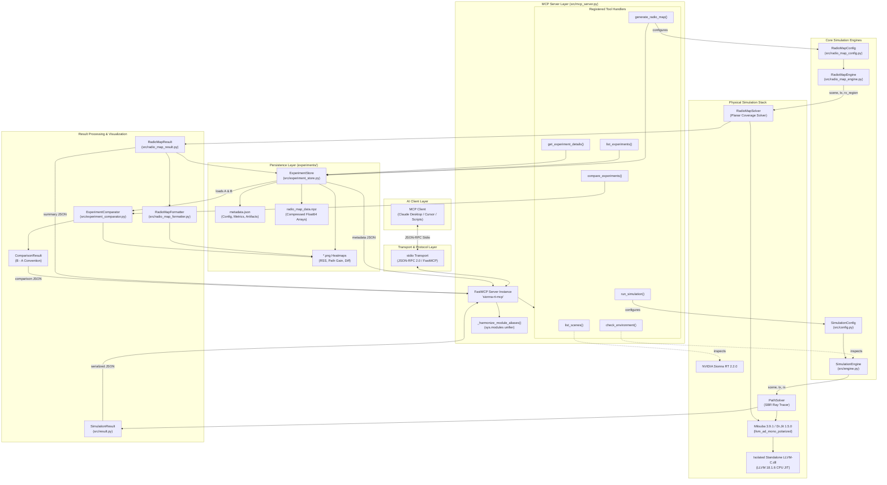

# NVIDIA Sionna RT MCP Server — Architecture Documentation

**Document Version:** 1.0  
**Target Platform:** Windows 11 64-bit  
**Runtime:** CPython 3.10.10, Sionna RT 2.2.0, Mitsuba 3.9.1, Dr.Jit 1.5.0, LLVM 18.1.6  
**Protocol:** Model Context Protocol (MCP) 1.30.0 over stdio transport  

---

## 1. Architectural Philosophy and Design Principles

The `sionna_rt_mcp` project provides an agentic bridge between AI clients (such as Claude Desktop, Cursor, or autonomous LLM agents) and NVIDIA Sionna RT, a state-of-the-art differentiable ray-tracing engine for wireless communications.

The architecture adheres strictly to the following core software engineering principles:

1. **Strict Layered Separation of Concerns:**
   - The **MCP Server Layer** (`src/mcp_server.py`) acts solely as an interface adapter. It handles JSON-RPC message serialization, argument schema validation, tool registration, and error wrapping. It contains **no ray-tracing mathematics, scene-graph manipulation, or spatial comparison logic**.
   - The **Simulation Engine Layer** (`src/engine.py`, `src/radio_map_engine.py`) encapsulates all interactions with Sionna RT and Mitsuba 3.
   - The **Domain Model Layer** (`src/config.py`, `src/result.py`, `src/radio_map_config.py`, `src/radio_map_result.py`) provides strongly typed, immutable dataclasses.
   - The **Persistence Layer** (`src/experiment_store.py`) manages filesystem persistence, atomic writes, and pickle-free deserialization.
   - The **Spatial Analysis Layer** (`src/experiment_comparator.py`) performs numerical comparisons, difference masking, and statistical evaluation.

2. **Stateless Server with Stateful Filesystem Persistence:**
   - The MCP server process maintains no in-memory experiment cache across tool calls. Every query or comparison operates directly against validated filesystem artifacts managed by `ExperimentStore`. This guarantees process stability and crash immunity.

3. **Defensive Physical Plausibility & Numeric Integrity:**
   - RF power is strictly enforced in Watts ($W$) and dBm ($P_{\text{dBm}} = 10 \log_{10}(P_W) + 30$).
   - Path gains are strictly non-negative linear values converted to dB ($G_{\text{dB}} = 10 \log_{10}(G)$).
   - Zero-power / unreachable cells strictly evaluate to $-\infty$ (IEEE 754 `-inf`). The system never substitutes artificial RF noise floors for unreached cells.
   - Unreached cells are masked transparently in heatmaps and cleanly omitted from comparison statistics.

4. **Canonical Import Identity & Single Type Registry:**
   - Internal modules use canonical package imports (`from src.<module> import ...`) with fallback to local imports.
   - A runtime harmonization hook (`_harmonize_module_aliases`) binds module names in `sys.modules`, ensuring strict type identity and eliminating fragile class-name introspection fallbacks.

---

## 2. End-to-End System Architecture

The following Mermaid diagram illustrates the actual runtime architecture, data flows, and subsystem boundaries across the entire codebase:

---

## 3. Subsystem Breakdown and Responsibilities

### 3.1 Point-to-Point Ray Tracing Subsystem

The point-to-point subsystem simulates radio propagation between a single transmitter and a single receiver node in a 3D geometric scene.

- **`src/config.py` (`SimulationConfig`):**
  Defines carrier frequency (`frequency_hz`, default 3.5 GHz), scene identifier (`scene_name`), transmitter position (`tx_position`, default `[0.0, -10.0, 5.0]`), transmit power (`tx_power_dbm`, default 30.0 dBm), receiver position (`rx_position`, default `[0.0, 10.0, 5.0]`), and planar array antenna specifications (`pattern="iso"`, `polarization="V"`).
- **`src/engine.py` (`SimulationEngine`):**
  - Manages backend initialization via `ensure_mitsuba_variant()`.
  - Loads 3D meshes from `sionna.rt.scene` or filesystem XML.
  - Instantiates `PlanarArray`, `Transmitter`, and `Receiver`. Aligns transmitter towards receiver via `tx.look_at(rx)`.
  - Executes Sionna RT `PathSolver()`.
  - Extracts path amplitudes ($a \in \mathbb{C}$), delays ($\tau$), propagation distances ($d = \tau \cdot c$), individual path gains, total path loss, and interaction types (Line-of-Sight, Specular Reflection, Diffuse Scattering, Diffraction).
- **`src/result.py` (`SimulationResult`):**
  Immutable dataclass encapsulating all propagation metrics with property accessors and a full `to_dict()` JSON serialization method.
- **`src/formatter.py` (`format_result`):**
  Terminal formatter presenting physical propagation metrics in clear, human-readable ASCII tables.

---

### 3.2 Radio-Map Coverage Subsystem

The radio-map subsystem computes 2D spatial wireless coverage across continuous planar evaluation surfaces.

- **`src/radio_map_config.py` (`RadioMapConfig`):**
  - Comprehensive configuration dataclass validating all parameters before simulation.
  - Supports **AUTO** region bounding (dynamically extracted from scene geometry with configurable margin and transmitter inclusion) and **MANUAL** bounding ($x_{\min}, x_{\max}, y_{\min}, y_{\max}$).
  - Controls evaluation height (`receiver_height`, default 1.5 m) and spatial resolution (`cell_size`, scalar or $[dx, dy]$).
  - Configures ray budget (`samples_per_tx`), bounce recursion depth (`max_depth`), random seed, and ray types (LOS, reflections, diffraction, scattering).
  - Maps user-friendly antenna categories (`"isotropic"`, `"dipole"`, `"directional"`) to verified Sionna RT PlanarArray patterns (`"iso"`, `"dipole"`, `"tr38901"`).
- **`src/radio_map_engine.py` (`RadioMapEngine`):**
  - Instantiates transmitter antenna array, orientation, and power.
  - Computes receiver measurement plane bounding box and center coordinate.
  - Configures and executes Sionna RT's native `RadioMapSolver`.
  - Preserves spatial bounds and coordinate properties for downstream extractors.
- **`src/radio_map_result.py` (`RadioMapResult`):**
  - Extracts 2D linear received power (`rss_watts`), path gain (`path_gain_linear`), and 3D cell centers (`cell_centers`).
  - Converts linear fields to logarithmic representations:
    $$\text{RSS}_{\text{dBm}} = 10 \log_{10}(P_{\text{watts}}) + 30$$
    $$\text{PathGain}_{\text{dB}} = 10 \log_{10}(G_{\text{linear}})$$
  - Converts zero-power / unreached cells directly to $-\infty$ (`-inf`) without precision loss or synthetic noise floor injection.
  - Automatically derives 1D separable or 2D grid coordinates from cell centers upon instantiation.
- **`src/radio_map_formatter.py` (`RadioMapFormatter`):**
  - Renders 150 DPI publication-quality heatmaps for Received Signal Strength (`plot_received_power_heatmap`) and Path Gain (`plot_path_gain_heatmap`).
  - Utilizes Matplotlib's `Agg` headless backend.
  - Masks unreachable cells ($-\infty$) transparently using `np.ma.masked_where` and colors them with a neutral light gray (`#dcdcdc`).

---

### 3.3 Experiment Persistence and Comparison Subsystem

- **`src/experiment_store.py` (`ExperimentStore`):**
  - Manages atomic filesystem storage under `experiments/experiment_<timestamp>_<uuid>/`.
  - Atomic write strategy: Files are prepared in temporary staging folders (`.tmp_*`) and renamed to the final destination in a single atomic OS filesystem operation.
  - Numerical arrays are stored in compressed NPZ (`radio_map_data.npz`) using strict `float64` typing.
  - Deserialization enforces `allow_pickle=False` to eliminate arbitrary code execution vulnerabilities.
  - Validates all experiment IDs against path traversal patterns (`../`, `..\`, `/`).
- **`src/experiment_comparator.py` (`ExperimentComparator`):**
  - Enforces spatial compatibility across 7 criteria: scene name, receiver height, grid dimensions, cell size, region bounds, cell centers, and coordinate vectors.
  - Implements the strict **$B - A$ (Experiment B minus Experiment A)** convention:
    $$\Delta \text{RSS}_{\text{dBm}} = \text{RSS}_B - \text{RSS}_A$$
    $$\Delta \text{PathGain}_{\text{dB}} = \text{PathGain}_B - \text{PathGain}_A$$
  - Unreached cells in either experiment are masked as `NaN` in delta matrices and excluded from statistical metrics.
  - Renders centered diverging difference heatmaps (`PuOr` colormap) with neutral gray masking for invalid cells.

---

### 3.4 MCP Server Interface Layer

- **`src/mcp_server.py`:**
  - Built with the official Python Model Context Protocol SDK (`mcp==1.30.0`, `FastMCP`).
  - Exposes all 7 tools over standard I/O (`stdio` JSON-RPC transport).
  - Performs schema validation using Pydantic field annotations.
  - Maps internal exceptions (`ValueError`, `FileNotFoundError`, `RuntimeError`) to formal MCP `ToolError` instances with descriptive user-facing diagnostics.
  - Provides `_harmonize_module_aliases()` to ensure consistent module identity in `sys.modules`.

